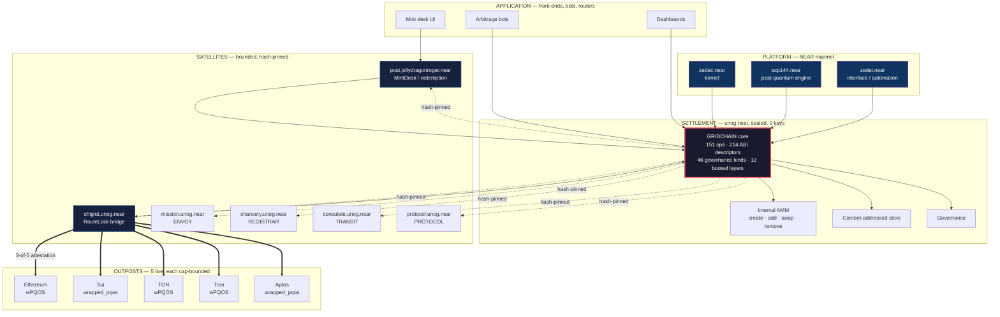
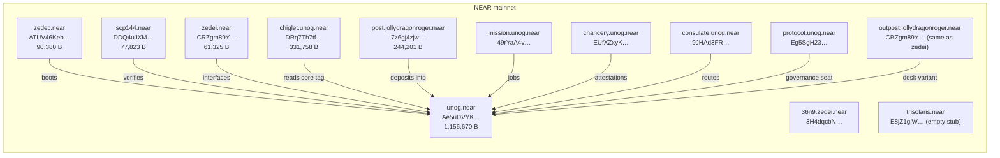
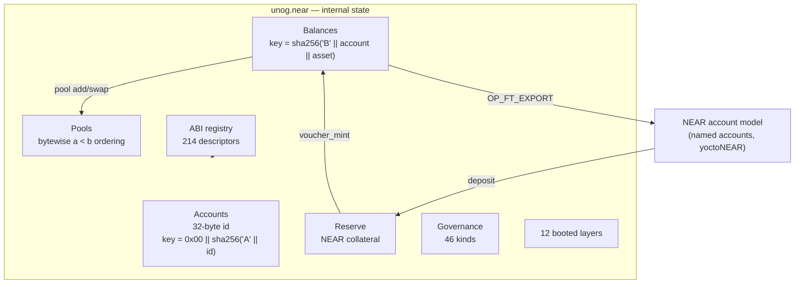
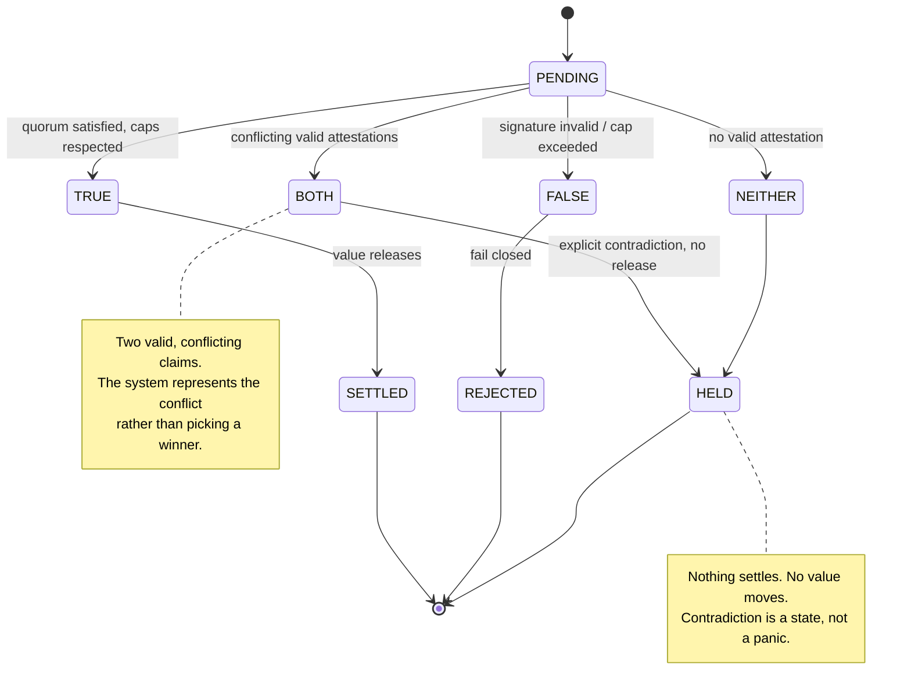
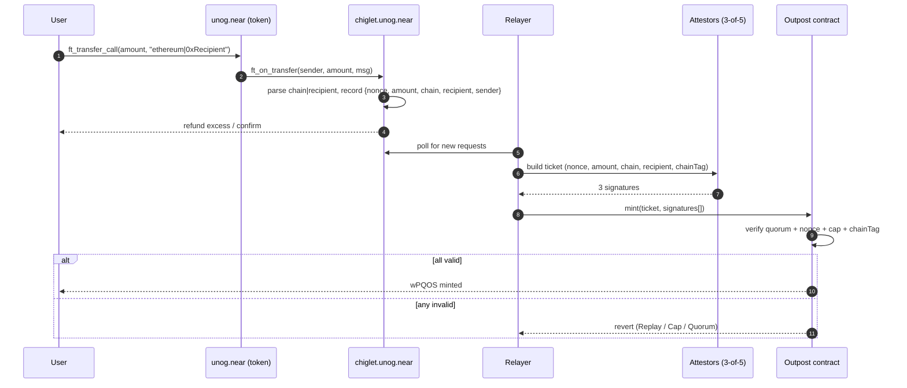
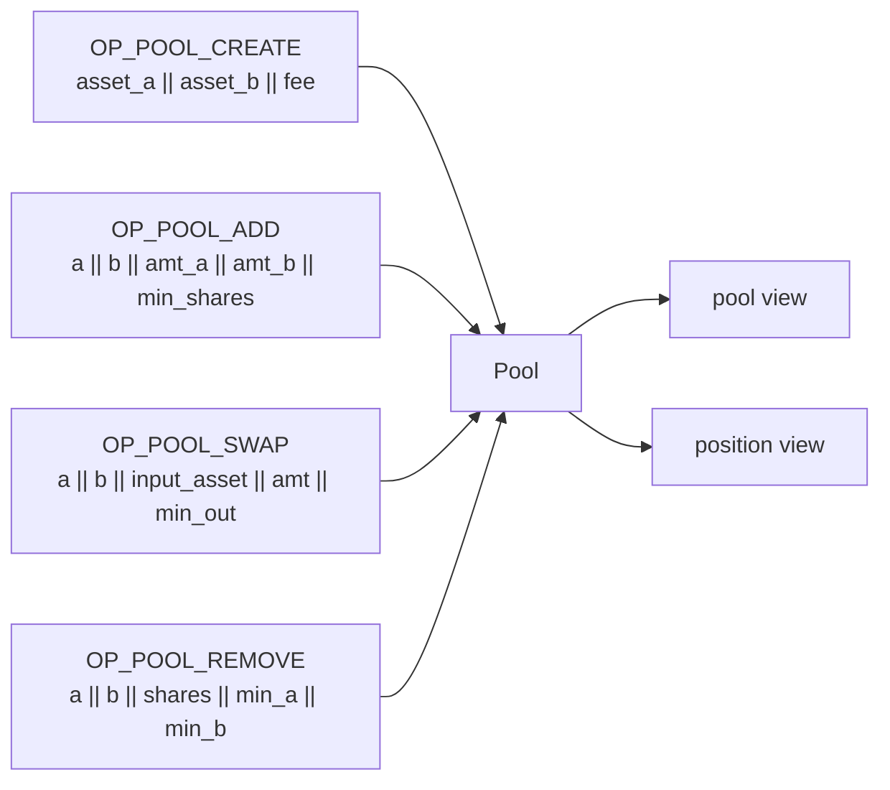

# Architecture

The system is one vertical stack: a sealed chain running inside a NEAR
contract, wrapped in satellites, bridged to five external chains, with every
layer addressable and every byte published.

---

## 1. The stack



**ASCII fallback**, for terminals and print:

```
   APPLICATION      mint UI        arbitrage bots      dashboards
                       |                  |                 |
                       v                  v                 v
   SETTLEMENT     +----------------------------------------------+
   unog.near      |  GRIDCHAIN core - SEALED - ZERO ACCESS KEYS   |
   (1,156,670 B)  |  151 ops | 214 ABI | 46 governance | 12 layers|
                  |  internal AMM | content store | governance    |
                  +----------------------------------------------+
                       ^          ^          ^          ^
                       |          |          |          |
   SATELLITES     chiglet    post.jolly   mission    chancery / consulate / protocol
                  (bridge)   (mint desk)  (ENVOY)    (REGISTRAR / TRANSIT / PROTOCOL)
                       |
                       | 3-of-5 attestation, immutable cap per chain
                       v
   OUTPOSTS      Ethereum    Sui     TON     Tron    Aptos

   PLATFORM      zedec.near (kernel) | scp144.near (PQ) | zedei.near (interface)
```

---

## 2. Contract topology



---

## 3. The sealed core

`unog.near` is a blockchain inside a contract. It owns its own accounts,
balances, nonces and state — separate from NEAR's account model.



**Storage key derivation** — this is the thing every client gets wrong:

| Record | Key |
|---|---|
| Account | `0x00 ‖ sha256("A" ‖ account_id)` |
| Balance | `sha256("B" ‖ account_id ‖ asset_id)` |
| NEAR→GRIDCHAIN account | `sha256("near-account:" ‖ accountId)` |

**There is no prefix scan.** A balance key hashes its preimage, so you cannot
enumerate accounts from keys — you must compute the key for a candidate and
look. That is deliberate: it makes the account set opaque while keeping every
individual balance provable.

---

## 4. The four-valued state machine

The protocol does not collapse contradictions. A verdict is one of four
values, and only one of them settles.



This is the paraconsistent core: `BOTH` is a first-class outcome, not an
error. A last-writer-wins system would silently pick one attestation; this one
stops and records that it cannot decide.

---

## 5. The token

TIAMAT (PQOS) is a 24-decimal NEP-141 asset with no admin mint.

```mermaid
graph LR
    USER["User"] -->|deposit NEAR| RES["Reserve"]
    RES -->|price = phi^(21 × S / cap)| MINT["voucher_mint"]
    MINT -->|credit| L2["Internal GRIDCHAIN balance"]
    L2 -->|OP_FT_EXPORT| WALLET["NEP-141 wallet"]
    WALLET -->|ft_transfer_call| DESK["MintDesk"]
    DESK -->|voucher_redeem| BURN["Burn PQOS"]
    BURN -->|pro-rata slice| RES
    RES -->|payout| USER
    L2 -->|pool ops| AMM["Internal AMM"]
    WALLET -->|lock| BRIDGE["RouteLock"]
    BRIDGE -->|wrapped| OUT["Outpost"]
    OUT -->|burn| BRIDGE
    BRIDGE -->|release| WALLET
```

**The curve.** `backing per new TIAMAT = phi^(21 × supply / cap)`. Because the
exponent rises with supply, collateral per token rises monotonically and
supply approaches the cap asymptotically. Nobody can accelerate issuance by
waiting — issuance is bounded by collateral, not by time.

```
price
  ^                                        ......... cap = 144e9
  |                                 .....
  |                          .....
  |                   .....
  |            .....
  |      .....
  | ....
  +-------------------------------------------------> supply
   0                                           144,000,000,000
```

---

## 6. The bridge



**`msg` is pipe-separated, not JSON.** The core parser rejects escaped quotes,
so a nested JSON message is silently refunded. This cost us a real transaction
to discover; it is documented here so it does not cost you one.

**Trust model.** The bridge is *attested*, not trustless. A 3-of-5 quorum can
mint on the destination chain, bounded by an immutable per-outpost cap. A
compromised quorum cannot exceed the cap and cannot mint on NEAR.

---

## 7. The internal AMM



**Ordering matters:** `asset_a` must sort bytewise before `asset_b`. The NEAR
asset is all zeroes, so it always comes first. Wrong order returns `range` —
not an error message, just `range`.

---

## 8. What is proven, and what is not

| Claim | Status |
|---|---|
| 13 contracts deployed, hashes published | **verified** — every WASM SHA-256 matches chain |
| `unog.near` sealed with zero keys | **verified** — `view_access_key_list` returns empty |
| Mint, redeem, export, transfer | **proven on-chain** — see `FORENSIC_LEDGER.md` |
| Internal AMM create/add/swap/remove | **proven on-chain** |
| Lock → attest → mint on Ethereum | **proven** — 0.5 PQOS route completed |
| Sui, TON, Tron, Aptos contracts live | **verified** — deployed, capped, configured |
| Deep liquidity on any venue | **NOT YET** — pools hold fractions of a token |
| Trustless bridging | **NO** — 3-of-5 attested, cap-bounded, and we say so |
| Admin mint, pause, upgrade | **DOES NOT EXIST** — no such function, no key |

The last three lines are the ones a reviewer should check first. We would
rather be judged on an accurate description than a flattering one.
