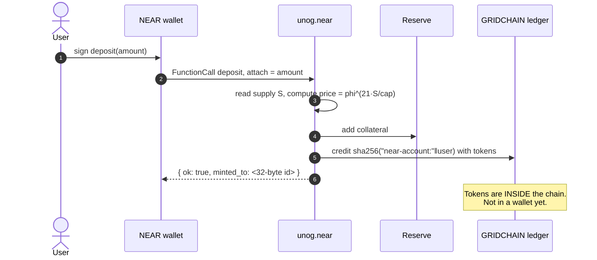
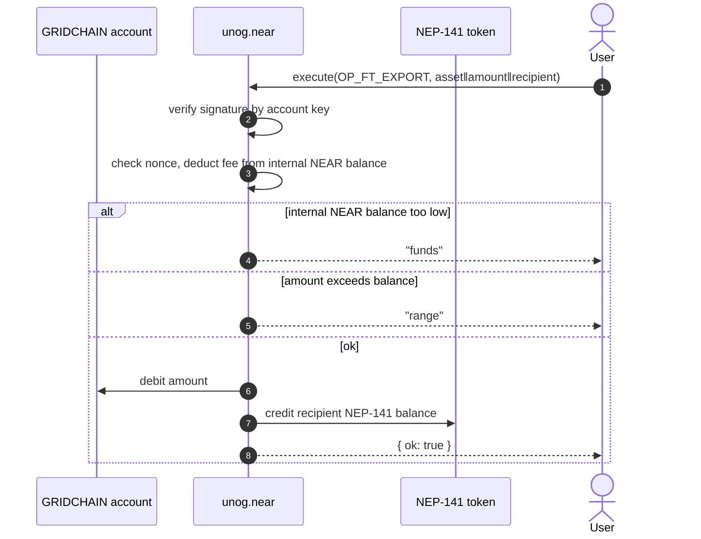
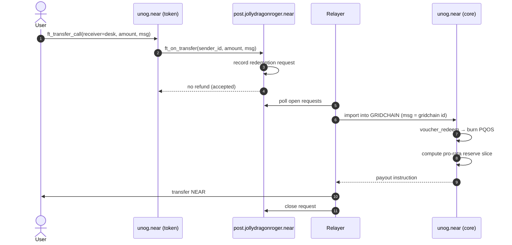
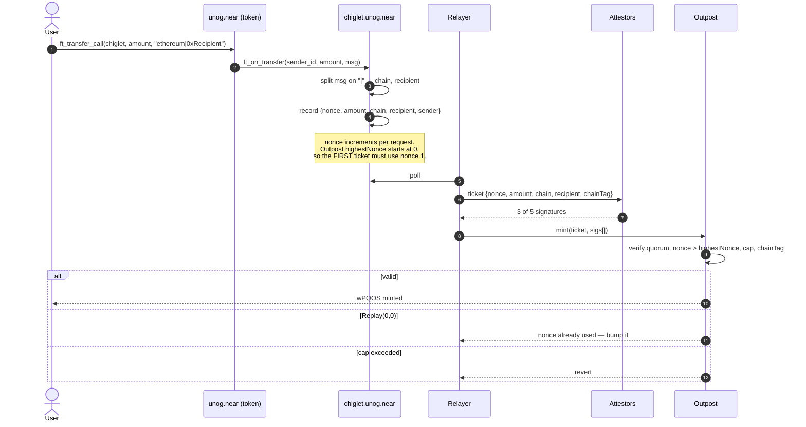
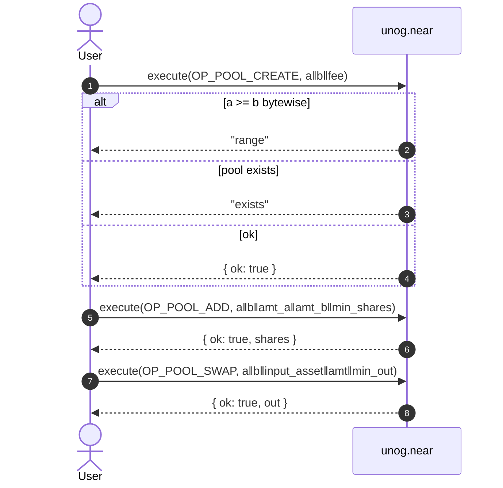
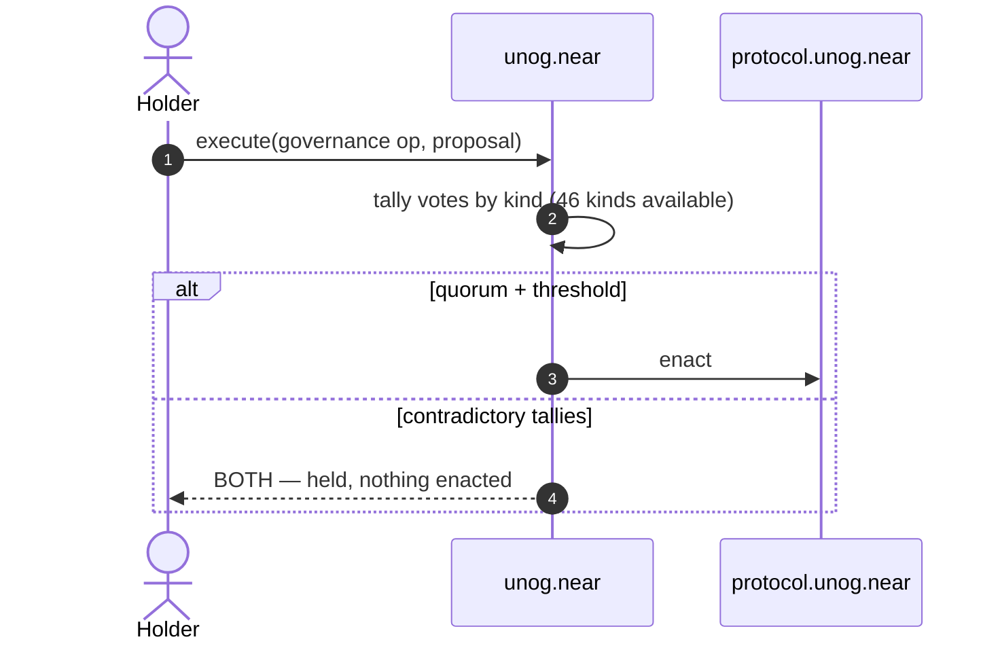

# Transaction flows

Every flow below is a real, executed path. Transaction IDs are from
`FORENSIC_LEDGER.md`.

---

## 1. Mint — NEAR collateral → TIAMAT



**The critical detail:** `deposit` credits an internal account. The user's
wallet still shows nothing. A second step — export — is required.

```
Step 1  deposit     → internal balance   (visible only via storage)
Step 2  export      → NEP-141 wallet     (visible everywhere)
```

Anyone building a UI must show both steps, or users will believe they lost
their money. That is not a bug in the protocol; it is the account model.

---

## 2. Export — internal balance → wallet



**Two failure modes, both seen in practice:**

| Result | Meaning | Fix |
|---|---|---|
| `funds` | internal account has no NEAR for the op fee | deposit a little NEAR to that account |
| `range` | amount > actual balance | read the balance record, do not guess |

**Nonce hazard.** Every failed attempt still advances the account nonce.
Retrying with the same nonce after a failure will fail forever. Read the
nonce from the account record — `0x00 ‖ sha256("A" ‖ id)` — before signing.

Proven transaction: `Bt7XGov4zqq7dKCmCGTkj16YyMy51hCsnn133ZiFXXAB` (47 PQOS
exported).

---

## 3. Redeem — TIAMAT → NEAR



**Snake_case matters.** The sealed core calls `ft_on_transfer` with
`{sender_id, amount, msg}`. A contract built with near-sdk's `#[near]` macro
renames arguments to camelCase, the deserialiser fails, and the transfer is
**silently refunded** with no error. Both `chiglet.unog.near` and
`post.jollydragonroger.near` use `#[near_bindgen]` for exactly this reason.

---

## 4. Bridge — lock on NEAR, mint on another chain



**Message format:** `chain|recipient`. Not JSON. The core parser rejects
escaped quotes, so `{"chain":"ethereum"}` is refunded silently.

**Fee:** 8.889 bps (889 ppm), readable at `chiglet.unog.near.fee_ppm()`.

**Proven routes:**

| Amount | Route | Result |
|---|---|---|
| 0.01 PQOS | NEAR → Ethereum | wPQOS minted |
| 0.5 PQOS | NEAR → Ethereum | 0.5095555 wPQOS (889 ppm fee measured) |

---

## 5. Internal AMM



**Asset ordering is mandatory.** `asset_a` must sort bytewise before
`asset_b`. The NEAR asset is all zeroes, so it always goes first. Wrong order
returns `range` — not a helpful message, just `range`.

Proven transactions:

| Op | Tx |
|---|---|
| pool create | `GynBWFRF…` → `exists` (already created) |
| pool add (0.7 PQOS + 0.7 NEAR) | `Bk2ESGkUAigjBfWeVeMNqQvc4mnN58U51YUWWvUcPL2e` |
| pool swap (NEAR → PQOS) | `4rvZ6odPddcYQkx25Bke93TR4vcm3LgLKjaC5jL2D18F` |
| transfer (1 PQOS) | `BBEjz98AcspMSu4vNBD2mKp7TXaT3SoskArfeA9Vqihq` |
| export (47 PQOS) | `Bt7XGov4zqq7dKCmCGTkj16YyMy51hCsnn133ZiFXXAB` |

---

## 6. Governance



`BOTH` is a legitimate outcome. When two valid, conflicting proposals pass,
the system records the contradiction and enacts neither. A conventional
chain would resolve it by majority and lose the information that the
community disagreed.

---

## 7. Failure catalogue

Every one of these was hit for real and is documented so it is not hit again.

| Symptom | Cause | Fix |
|---|---|---|
| `range` on pool op | assets not in bytewise order | NEAR (zeros) first |
| `exists` on pool create | pool already created | use add instead |
| `funds` on export | internal account has no NEAR for fee | deposit NEAR to that account |
| `range` on export | amount > actual internal balance | read the balance record |
| silent refund on `ft_on_transfer` | camelCase args vs snake_case caller | use `#[near_bindgen]` |
| `E28: Illegal msg` on Ref | bare pool id is not a valid msg | Ref uses a different schema |
| `Replay(0,0)` on outpost mint | nonce already used | bump nonce; first ticket is 1 |
| export never lands | nonce advanced by failed attempts | read nonce from account record |
| `unknown letter I` on NEP-413 | service cannot parse `ml-dsa-65:` | use the ed25519 key |
| balance reads 0 | RPC rate limit | re-query a different RPC before alarming anyone |
